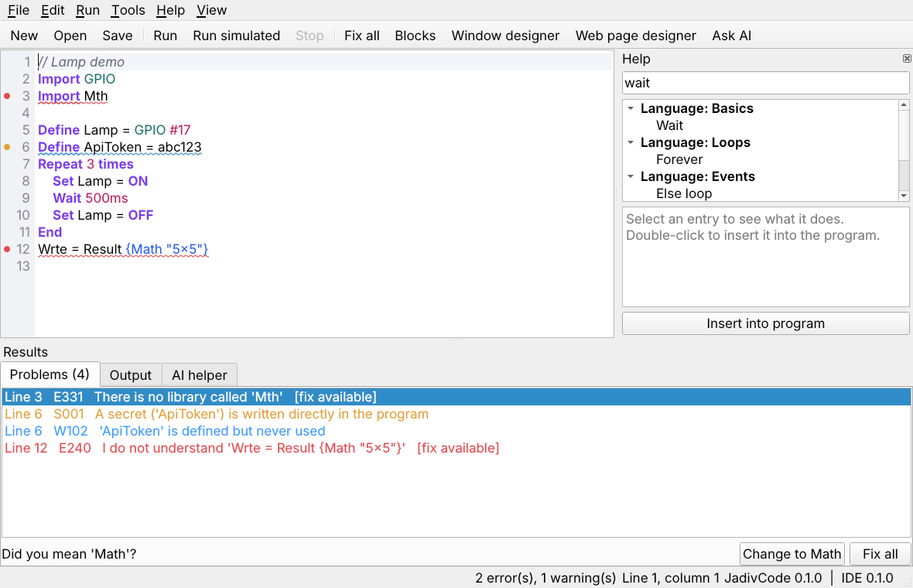
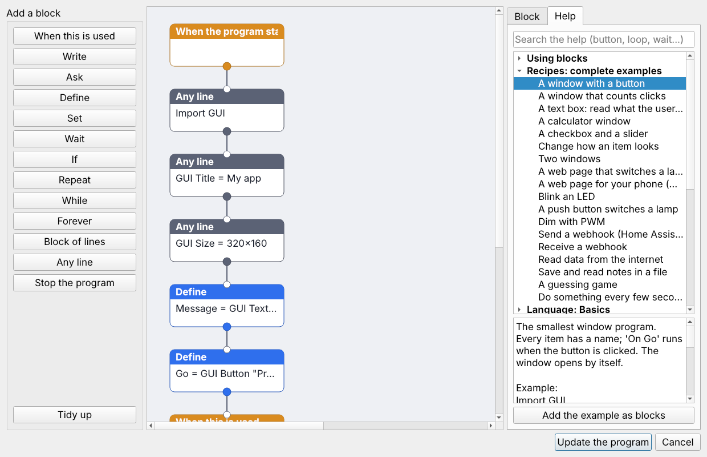
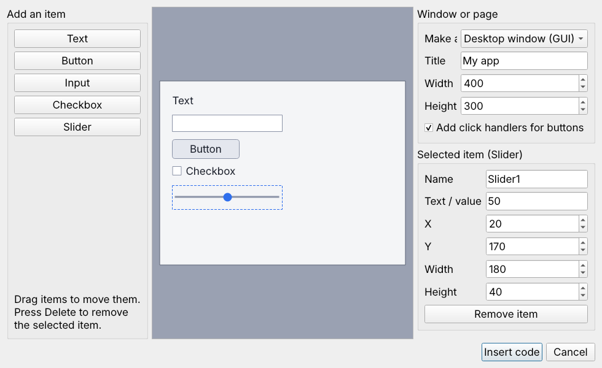

# JadivCode IDE

A desktop editor made for JadivCode. You can type programs, build them
from blocks, or design windows and web pages with the mouse.



## Install

Install [JadivCode](../install.md) first, then:

```bash
curl -fsSL https://raw.githubusercontent.com/JadivCode/jadivcode-ide/main/install.sh | bash
```

```bash
sudo apt install python3-pyqt5
```

Start it from the application menu or with `jadivcode-ide`.

## The window

| Part | What it does |
|---|---|
| Editor | Colors the words, numbers the lines, indents blocks for you |
| Problems | Lists mistakes and unsafe code while you type |
| Output | Shows what the program writes; type answers for `Ask` in the line below |
| Help | The whole language and every library, with a search box |

## Running

| Button | Key | Meaning |
|---|---|---|
| Run | ++f5++ | Save and run the program |
| Run simulated | ++shift+f5++ | Run without hardware or a screen |
| Stop | ++ctrl+f5++ | Stop the running program |

## Fixing problems

A problem is underlined in the editor and gets a dot next to its line
number: red for an error, yellow for a warning, blue for a tip. Select it
in **Problems** to read the hint.

- **Apply fix** repairs the selected problem when a fix is available.
- **Fix all** (++ctrl+shift+f++) applies every available fix.
- ++ctrl+z++ undoes a fix.

## Help panel

Type a word such as `button`, `loop` or `wait` into the search box.
Select an entry to read what it does and see an example. Double-click it,
or press **Insert into program**, to put the example into your program.

The panel contains:

- **Recipes**: complete small programs, such as a window with a button, a
  calculator, a web page that switches a lamp, a blinking LED or a webhook
- every statement and helper of the language
- every command of every library
- every finding of the checker

## Blocks

**Tools → Blocks** (++ctrl+b++) shows the program as blocks that you join
with the mouse.



Blocks and text are two views of the same program:

- Opening Blocks reads the program text, including what you typed by hand.
- **Update the program** writes the blocks back as text.

So you can start with blocks, continue in text, and return to blocks.

### Working with blocks

1. Add blocks from the list on the left. A new block is joined to the
   selected block, or to the end of the program.
2. Drag from a coloured dot at the bottom of a block to the block that
   comes next. Drag a dot to empty space to remove its link.
3. Select a block to fill in its values on the **Block** tab.
4. Press **Update the program**.

| Block | Meaning |
|---|---|
| Program starts here | The beginning of the program |
| When this is used | Runs its blocks when an item, pin or event is used (`On`) |
| Write, Ask, Define, Set, Wait | The statements of the same name |
| If | Three dots: `yes`, `no`, and `next` for what happens afterwards |
| Repeat, While, Forever | An `inside` dot for the blocks they repeat |
| Block of lines | A `For` loop or a `Function`, with an `inside` dot |
| Any line | One line of JadivCode, for everything else |
| Stop the program | Ends the program |

Press ++delete++ to remove the selected block. **Tidy up** arranges all
joined blocks in neat columns.

The positions of the blocks are saved in the last line of the program
(`// blocks: ...`). They are reused as long as the text still matches;
after you change the text, the blocks are laid out again.

### Help and recipes inside Blocks

The **Help** tab holds the same help as the main window and a guide to
using blocks. Choose a recipe, for example *A window with a button*, and
press **Add the example as blocks**: the whole example appears as joined
blocks, ready to change.

Windows and web pages are built from ordinary blocks: one **Define** block
per item, and a **When this is used** block with the item's name for what
happens when it is used.

## Designers

**Tools → Window designer** (++ctrl+d++) and **Web page designer**
(++ctrl+shift+d++) let you place items with the mouse.



1. Add texts, buttons, inputs, checkboxes and sliders from the left.
2. Drag them into place. They snap to a 5 pixel grid.
3. Edit the name, text and size on the right.
4. Press **Insert code**, or **Update the program** when the program
   already has a window.

The designer writes lines such as:

```text
Define Button1 = GUI Button "Press me" at 20, 60 size 110, 32
```

and, when you leave the box ticked, an `On Button1 ... End` block for each
new button.

The designers work in both directions. When the program already contains a
window or page, the designer opens it, and **Update the program** changes
those lines where they are:

- Your other lines, comments and handlers stay untouched.
- Renaming an item renames it everywhere in the program.
- Removing an item also removes its `On` handler.

A web page places items from top to bottom in the order you arrange them.

## Updates

**Help → Check for updates** looks for a newer JadivCode and JadivCode
IDE. When one exists, the IDE shows the old and new version numbers and
asks before it installs anything. The update runs the same installers as
the first installation and shows their output on the **Output** tab.
Restart the IDE afterwards.

The IDE also looks once when it starts, quietly in the background. You
only hear about it when there is something new. Switch this off with
**Help → Check for updates at start**.

- The check downloads two small files from GitHub. Nothing about you or
  your programs is sent.
- If you say no, the check at start does not ask about the same version
  again. **Check for updates** in the menu always asks.
- A copy that was not installed with the installer (for example from Code
  Master or a git folder) is only reported; update it the way you
  installed it.

## AI helper

**Tools → Ask AI** explains the problems in plain words. It is optional
and asks before it sends your program anywhere. See [AI helper](ai.md).
